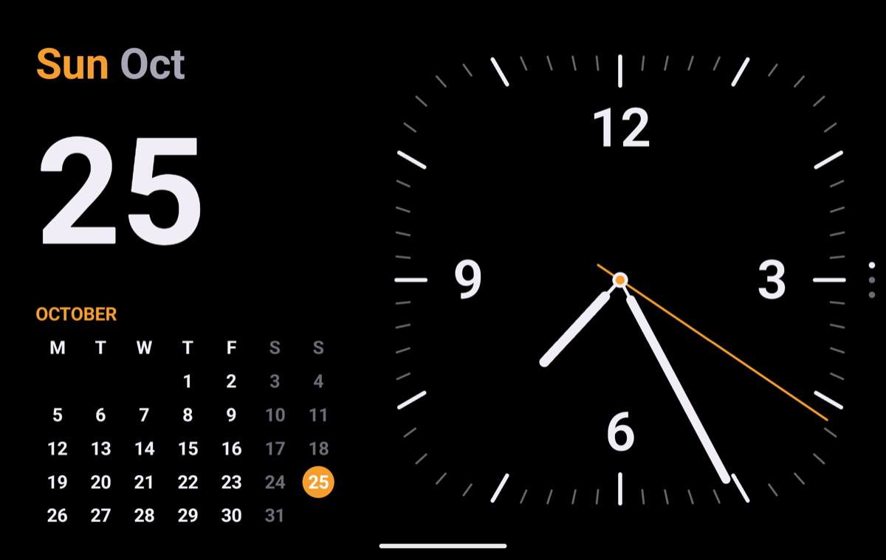
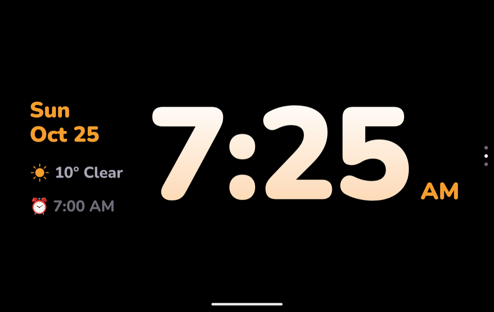
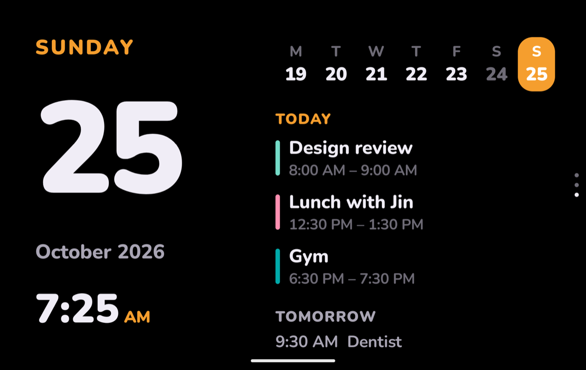
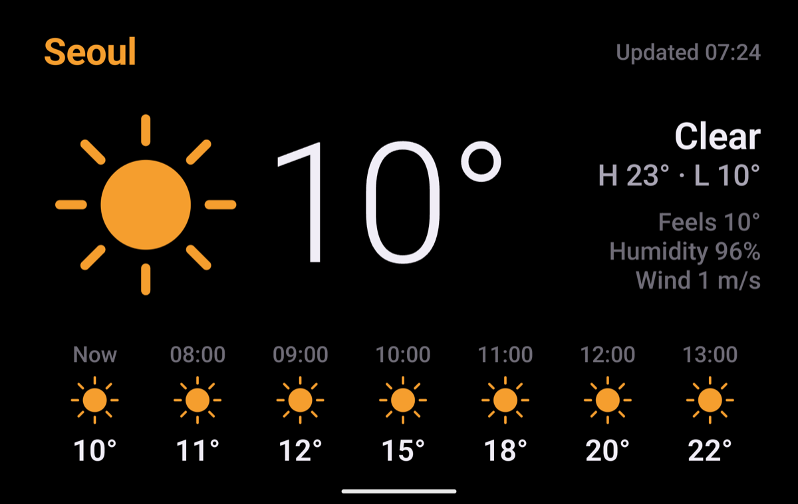
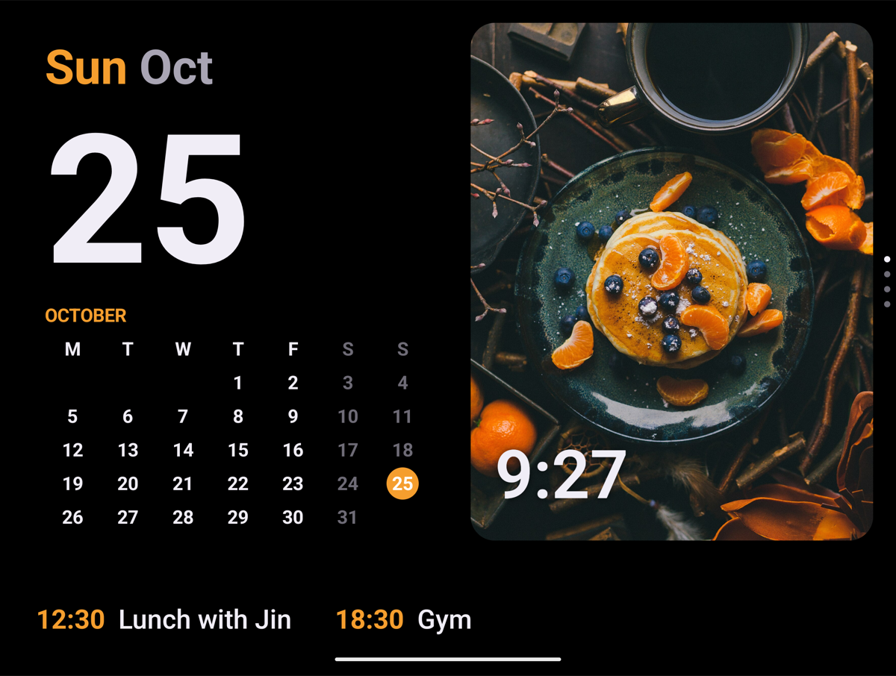
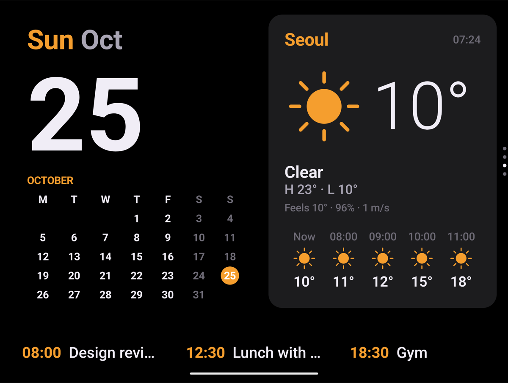
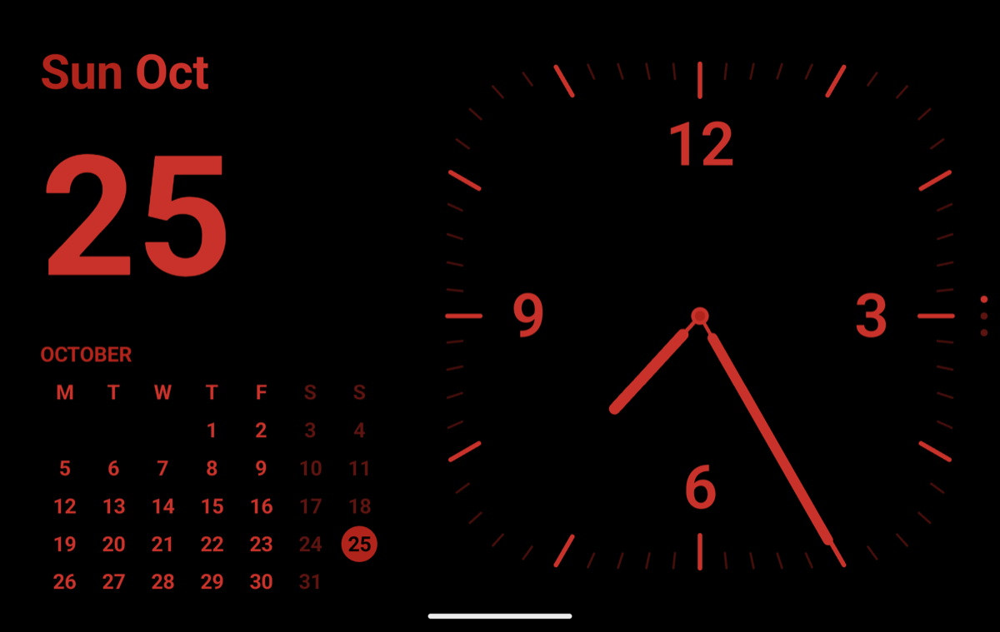
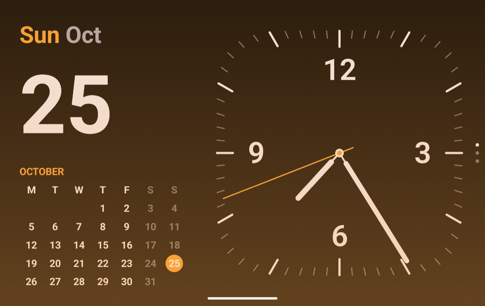
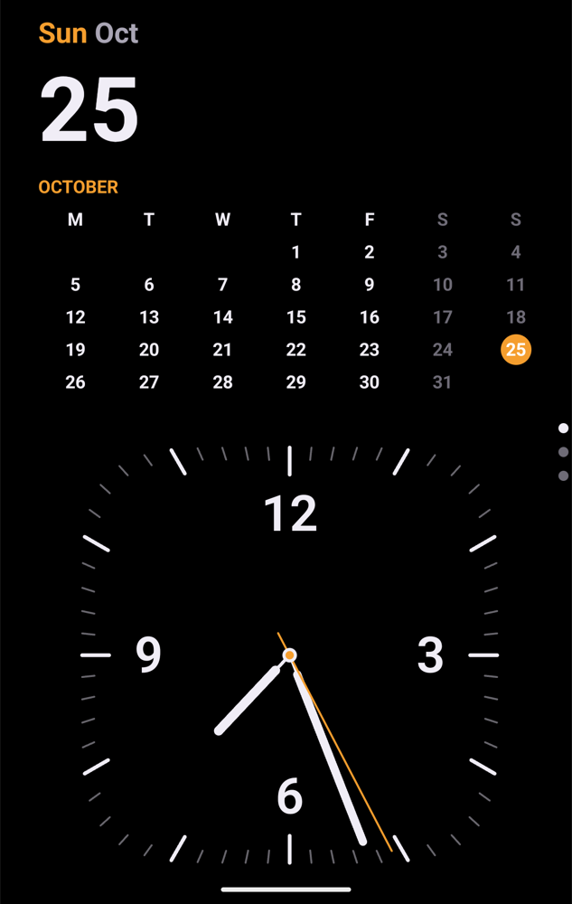
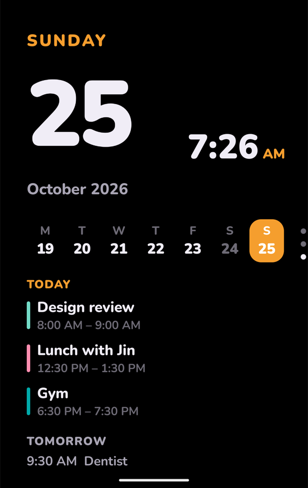

# Fold StandBy

> **갤럭시 Z Fold8 와이드 전용이에요.** Z Fold8 울트라는 화면 크기가 달라 지원하지 않아요.

갤럭시 Z Fold8 와이드를 충전기에 올려 두면 아이폰 스탠바이처럼 시계·달력·날씨·음악·사진을 크게 보여주는 앱이에요. 접은 커버 화면, 활짝 펼친 화면, 책처럼 반쯤 접어 세운 자세 모두에 맞춰 보여줘요.

- 플레이 스토어에는 없어요. 아래 안내대로 APK 파일을 받아 직접 설치해요.
- 무료이고, 광고나 계정 가입이 없어요. 일정·사진은 폰 안에서만 읽고 어디에도 보내지 않아요.
- Z Fold8 와이드(커버 화면 1248×1972, 펼친 화면 2448×1848)에 맞춰 만들었어요. 개발에 쓴 폰의 모델 번호는 SM-F971N이에요. 내 폰 모델은 설정 › 휴대전화 정보에서 확인할 수 있어요.
- Z Fold8 울트라나 Android 12 이상의 다른 폰에서도 켜지기는 하지만, 화면 배치가 어긋나거나 펼친 화면의 카메라 자리를 제대로 피하지 못할 수 있어요.

## 스크린샷

예시 데이터로 찍은 화면이에요. 일정과 사진은 예시이고, 날씨는 실제 서울 날씨예요. 사진 카드의 팬케이크 사진은 Joseph Gonzalez의 CC0 사진이에요([Wikimedia Commons](https://commons.wikimedia.org/wiki/File:Pancakes_(Unsplash).jpg)).

| 커버 화면 · 달력 + 시계 (기본) | 디지털 |
|---|---|
|  |  |
| **달력 · 오늘·내일 일정** | **날씨** |
|  |  |
| **펼친 화면 · 사진 카드** | **펼친 화면 · 날씨 카드** |
|  |  |
| **야간 모드** | **알람 전 은은한 빛** |
|  |  |

<p>
  
  
</p>

## 설치하기

컴퓨터 없이 폰만으로 설치할 수 있어요. 5분쯤 걸려요.

### 1. APK 파일 받기

1. 폴드8 와이드에서 이 페이지를 열어요.
2. [최신 버전 받기](https://github.com/svmark/fold-standby/releases/latest) 페이지의 **Assets** 아래에서 `FoldStandBy-1.0.0.apk`를 눌러 내려받아요.
3. "이 유형의 파일은 기기를 손상시킬 수 있습니다" 같은 안내가 나오면 **다운로드**를 눌러요.

### 2. 자동 차단 끄기 (켜져 있을 때만)

삼성 폰은 **자동 차단**이 켜져 있으면 플레이 스토어 밖의 앱을 설치할 수 없어요.

- 설정 › 보안 및 개인정보 보호 › **자동 차단** › 끄기

설치가 끝나면 다시 켜도 돼요. 앱은 그대로 동작해요.

### 3. 설치하기

1. 알림창이나 **내 파일 › 다운로드**에서 `FoldStandBy-1.0.0.apk`를 눌러요.
2. "이 출처의 앱을 설치하도록 허용되지 않았어요"가 나오면 **설정**을 누르고 **이 출처 허용**을 켠 뒤 뒤로 돌아와요.
3. **설치**를 눌러요.
4. Play 프로텍트가 "확인되지 않은 앱"이라고 하면 **세부정보 더보기 › 그래도 설치**를 눌러요. 플레이 스토어에 올리지 않은 개인 앱이라 나오는 안내예요.

설치가 끝나면 앱 목록에 **Fold StandBy** 아이콘이 하나 생겨요.

## 처음 설정

**Fold StandBy**를 처음 열면 설정 화면이 먼저 나와요. 위에서부터 차례로 하면 돼요.

### 1. 충전할 때 자동으로 켜기

1. **화면 보호기 설정 열기**를 눌러요.
2. 목록에서 **Fold StandBy**를 골라요.
3. 시작 조건(언제 시작할지)을 **충전 중**으로 바꿔요.

이제 충전 중에 화면이 꺼질 때 스탠바이 화면이 켜져요. 메뉴가 안 보이면 설정 검색창에 "화면 보호기"를 입력해요.

### 2. 권한 허용

| 권한 | 쓰는 곳 | 허용하지 않으면 |
|---|---|---|
| 캘린더 | 오늘·내일 일정 | 일정이 안 보여요 |
| 대략적 위치 | 지금 있는 곳의 날씨 | 서울 날씨를 보여줘요 |
| 알림 접근 | 재생 중 음악, 새 알림, 알람이 울리는 동안 빛 유지 | 음악·알림 화면이 비어 있어요 |
| 사진 | 펼친 화면 오른쪽 사진 카드 ("사진 접근 허용하고 앨범 고르기"에서 물어요) | 사진 카드가 비어 있어요 |

**알림 접근**이 회색으로 막혀 켜지지 않으면, 설정 › 애플리케이션 › Fold StandBy › 오른쪽 위 **⋮** › **제한된 설정 허용**을 누른 뒤 다시 켜요. 직접 설치한 앱이라 한 번 더 확인하는 단계예요.

### 3. 표시 고르기

- **언어**: 처음에는 English예요. 요일·월·날씨를 한글로 보려면 **한국어**를 골라요.
- **주 시작**: 월요일 또는 일요일
- **강조색**: 주황(기본)·노랑·흰색·민트·분홍
- **야간 모드**: 자동이면 방이 어두울 때 화면 전체가 어두운 빨강으로 바뀌어요.
- **펼친 화면 오른쪽 스택**: 사진을 보여줄 앨범을 골라요.
- **침대 옆 시계**: 알람 전 은은한 빛, 움직이면 깨우기를 켜고 끌 수 있어요(아래 설명).

다 했으면 **스탠바이로 돌아가기**를 눌러요.

### 4. 무선 충전기에서도 바로 켜기 (선택)

화면 보호기는 화면이 꺼질 때 켜져서, 무선 충전기에 올리면 Always On Display가 먼저 나오고 한참 뒤에 바뀔 수 있어요. 바로 켜려면 삼성 **모드 및 루틴**에 루틴을 하나 만들어요.

1. 설정 › 모드 및 루틴 › **루틴** › **+**
2. **조건 추가(만약)** › 충전 상태 › **무선 충전** › 완료
3. **동작 추가(그러면)** › 앱 › 앱 열기 › **Fold StandBy** › 완료
4. 저장하고 이름을 "무선 스탠바이"처럼 붙여요.

유선 충전 때도 바로 켜고 싶으면 2번에서 **충전 중**을 고르면 돼요.

## 쓰는 법

- **좌우로 밀기**: 시계 → 날씨 → 재생 중 화면으로 바뀌어요.
- **시계 화면에서 위아래로 밀기**: 달력+시계 · 디지털 · 달력 스타일로 바뀌어요. 오른쪽 세로 점이 지금 스타일이에요.
- **길게 누르기**(1초쯤, 움직이지 않고): 설정 화면이 열려요.
- **닫기**: 아래에서 위로 밀거나 뒤로 가기. 충전기에서 떼면 저절로 닫혀요.
- 열 때마다 달력+시계 화면으로 시작해요.
- 폰의 화면 회전 잠금이 켜져 있어도 폰 방향대로 돌아가요.

### 화면별 모습

- **커버 화면**: 화면 전체에 보기 하나를 크게 보여줘요.
- **펼친 화면**: 왼쪽은 날짜와 이번 달 달력, 오른쪽은 위아래로 넘기는 카드(사진 · 시계 · 날씨 · 재생 중)예요. 사진은 고른 앨범에서 30초마다 바뀌고, 음악을 틀면 재생 중 카드로 넘어가요. 전면 카메라 자리는 비켜서 보여줘요.
- **반쯤 접어 세우기**: 윗면에 보기, 아랫면에 다음 일정이 나와요.

### 침대 옆에서

- **야간 모드**: 방이 어두우면 화면 전체를 어두운 빨강으로 바꾸고 밝기를 낮춰요.
- **알람 빛**: 폰 시계 앱의 다음 알람 15분 전부터 화면이 호박색으로 천천히 밝아져요. 알람을 끄면 원래대로 돌아가요.
- **움직이면 깨우기**: 밤에 1분 동안 아무 움직임이 없으면 화면을 거의 꺼요. 폰을 건드리거나 화면을 만지면 다시 켜져요.
- **번인 방지**: 1분마다 화면 전체를 조금씩 옮겨요.

## 자주 묻는 질문

**충전기에 올려도 안 켜져요.**
화면 보호기는 화면이 꺼질 때 시작해요. 화면이 꺼질 때까지 기다리거나 전원 버튼을 한 번 눌러 보세요. 그래도 안 되면 설정 › 디스플레이 › 화면 보호기에서 Fold StandBy와 "충전 중"이 골라져 있는지 확인해요. 바로 켜려면 위의 루틴을 만들어요.

**배터리가 가득 찬 뒤 무선 충전기에 올리면 안 켜져요.**
배터리 보호 설정에 따라 충전이 멈춰 있으면 폰이 충전 중이 아니라고 알려 줄 수 있어요. 이때는 앱 아이콘으로 직접 열어요.

**일정이 안 보이거나 늦게 보여요.**
폰의 캘린더에 들어온 일정만 보여요. 구글 캘린더 앱에서 방금 만든 일정은 동기화되는 데 잠깐 걸릴 수 있어요. 시간을 정하지 않은 구글 Tasks 할 일은 다른 앱이 읽을 수 없어 보이지 않아요. 시간을 정하면 보여요.

**음악 화면이 비어 있어요.**
알림 접근을 허용해야 해요. 위의 "제한된 설정 허용" 안내를 따라 해 보세요.

**새 버전은 어떻게 설치해요?**
[최신 버전 받기](https://github.com/svmark/fold-standby/releases/latest)에서 새 APK를 받아 같은 방법으로 설치하면 돼요. 지우지 않고 덮어 설치하면 설정이 그대로 남아요.

**지우려면요?**
앱 아이콘을 길게 누르고 **설치 삭제**를 눌러요. 화면 보호기 설정은 폰 기본값으로 돌아가요.

## 개발자용

Kotlin + Jetpack Compose로 만들었어요. 직접 빌드하려면 Android Studio에서 이 폴더를 열고 Run(▶)을 누르거나 터미널에서 실행해요.

```bash
./gradlew installDebug
```

```
app/src/main/java/com/marksnd/foldstandby/
├─ MainActivity.kt          설정·권한 안내
├─ StandbyActivity.kt       전체화면 스탠바이, 접힘 자세 감지
├─ StandbyDream.kt          충전 중 화면 보호기 (Compose를 DreamService에 연결)
├─ service/NotifListener.kt 알림 접근: 새 알림 전달, 미디어 세션 권한
├─ data/                    설정, 시각, 캘린더, 날씨(Open-Meteo), 배터리·알람·조도·움직임, 미디어, 사진
└─ ui/                      StandbyScreen(페이저), 시계 3종, 날씨, 재생 중, 펼친 화면 스택, 사진 카드, 알림 배너
```

기획 배경(아이폰 듀오 스탠바이 조사, 범위 결정, 화면 사양)은 [docs/plan-v6.html](docs/plan-v6.html)에 있어요. GitHub에서는 HTML 원문으로 보이니 내려받아 브라우저로 열어요.

## 라이선스

- 코드: [MIT](LICENSE)
- 글꼴 Nunito: SIL Open Font License 1.1 ([licenses/OFL-Nunito.txt](licenses/OFL-Nunito.txt))
- 날씨 데이터: [Open-Meteo](https://open-meteo.com/) (CC BY 4.0)
